# A Hybrid Crypto-Steganography Framework for Secure Image Transfer

## Abstract

Image sharing over the internet needs secure transmission (e.g., against MITM attacks). The paper proposes a **hybrid cryptography + steganography framework**: a secret payload is encrypted with one of three algorithms — **3DES**, **AES**, or **chaos-based encryption** — and the ciphertext is embedded into a **256×256 colour cover image** using **LSB steganography**. Dual-layer security = cryptographic protection + steganographic concealment.

- Implementation: **MATLAB R2024a**.
- Evaluated on cover, stego, secret, and recovered secret images with **PSNR, MSE, SSIM** and other parameters.
- Findings: **AES-based embedding** gives slightly better perceptual quality (higher PSNR/SSIM) than 3DES and chaos; the **chaos-based** approach gives more randomness and robustness. Integrating encryption with LSB embedding improves both security and imperceptibility.

## 1 Introduction

- Image communication over insecure networks faces interception, tampering, unauthorized access.
- **Encryption alone** → confidentiality, but ciphertext looks suspicious and attracts attackers.
- **Steganography alone** → hides existence, but once detected, data is exposed.
- **Hybrid crypto-steganography**: encrypt sensitive data, then embed the ciphertext into image pixels → balance of robustness and invisibility.
- Paper outline: challenge → benefits of combining → related work → proposed framework (3DES, AES, Chaotic + PRNG Masking, each with LSB) → methodology & metrics → comparative results → conclusion & future work.

## 2 Joint Cryptography Steganography

- Cryptography (AES, DES, RSA) gives confidentiality/integrity but ciphertext looks like random noise → attracts attention; it does not conceal that communication exists.
- Steganography hides the presence of data in media (image/audio/video) but has no intrinsic security if extracted.
- Summary: *cryptography = secure but not invisible; steganography = invisible but not secure.*
- Joint approach: encryption and embedding are **correlated/complementary**, not merely sequential:
  1. Secret image/message is encrypted (strong confusion & diffusion) → noise-like encrypted image.
  2. Encrypted image is embedded into a cover image using LSB or another adaptive embedding technique. Embedding positions / bit layers may be influenced by the cryptographic key (interdependence).
  3. Extraction: retrieve data from stego image, then decrypt with the key to reconstruct the secret. Extracted data is meaningless without the key.

**Figure 1 – Block diagram of Joint Crypto Steganographic System** ([original](145987_assets/fig1_joint_crypto_stego_block_diagram.jpeg))

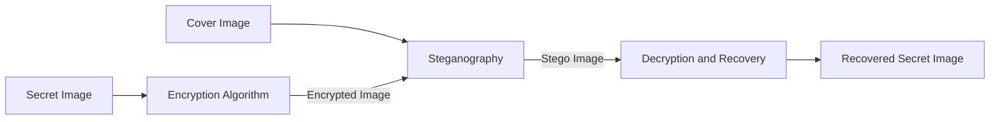

## 3 Related Work

- Various steganography-based data hiding methods: Kumar, Nagar & Kumar 2020.
- LSB hiding + genetic-algorithm-based encryption: Kaushik, Jain & Jain 2018.
- Integration of steganography and cryptography: Arora et al. 2021; Radha S. Phadte 2017.
- **DES + LSB** substitution (encrypt first, then embed into LSBs): Basri et al. 2018; Karthikeyan et al. 2017; Yang et al. 2014.
- **AES + LSB** hybrid protecting both content and existence (confidentiality, integrity, authentication): Abbas & Chong 2023; Chikouche & Noureddine 2017; Kotkar et al. 2022; M. Kumar et al. 2022; Ranjan & Bhosale 2016.

## 4 Methodology

Three methods implemented: **3DES-LSB**, **AES-LSB**, **Chaotic + PRNG Masking LSB**.

### 4.1 3DES (Triple Data Encryption Standard)

Symmetric block cipher applying DES three times per 64-bit block, usually **Encrypt-Decrypt-Encrypt (EDE)**, with two or three independent 56-bit keys. Commonly in **CBC mode** (each plaintext block XORed with previous ciphertext block).

1. Convert secret image to bytes; encrypt with 3DES, **192-bit (24-byte) key**, **64-bit (8-byte) IV**, CBC mode.
2. Determine LSB embedding capacity (**1–3 bits per colour channel**) from encrypted data size and cover pixel count.
3. Convert encrypted bytes to bitstream; embed into LSBs of RGB cover pixels.
4. Extract bits from stego LSBs, rebuild encrypted bytes, decrypt with same 3DES key + IV (EDE).
5. Recover secret image by reshaping decrypted bytes to original dimensions.
6. Compute quality metrics (MSE, PSNR, SSIM) and security metrics (NPCR, UACI, mean RGB channel correlation, entropy).

### 4.2 AES LSB

AES: symmetric block cipher, **128-bit blocks**, **128-bit key**; multiple rounds of substitution, permutation, mixing.

Workflow for AES-LSB image steganography:

1. Load all RGB cover images and the grayscale secret image.
2. Convert secret image to bytes; encrypt with **AES-128 (16-byte key + 16-byte IV, CBC mode)**.
3. Determine number of LSBs per colour channel (1–3) needed for the whole encrypted payload.
4. Convert AES-encrypted bytes to a bitstream.
5. Embed each bit into LSBs across R, G, B channels according to capacity.
6. Generate stego image.
7. Extract LSBs from stego → bitstream → bytes → decrypt with same AES key + IV.
8. Recover and reshape the secret image.
9. Compute MSE, PSNR, SSIM, NPCR, UACI, mean channel-wise correlation, entropy for each stego image.

### 4.3 Chaotic + PRNG Masking LSB Steganography

Combines (simulated) **elliptic curve cryptography (ECC)** and **chaotic masking (logistic map)** as a dual encryption layer before LSB embedding into RGB covers.

#### 4.3.1 Chaotic Mask Generation (Logistic Map)

Pseudorandom chaotic sequence $\{x_n\}$:

$$x_{n+1} = r \times x_n \times (1 - x_n) \tag{1}$$

- $x_0 = 0.785398$ (initial condition)
- $r = 3.999$ (system parameter)
- $x_n$ is generated iteratively and scaled to 0–255 to form the chaotic mask.

#### 4.3.2 ECC Mask (Simulated)

Pseudo-random byte sequence from a **fixed random seed**, simulating an ECC key stream.

**Combined encryption (XOR):** secret image bytes $S$ are XORed with both masks:

$$\text{encBytes} = S \oplus \text{chaosMask} \oplus \text{ecc\_key\_mask} \tag{2}$$

Double XOR → security from chaos-induced randomness + ECC key masking.

#### 4.3.3 Embedding Encrypted Bits

Encrypted bytes → bits → embedded into the `numLSB` least significant bits of cover pixels. If bits needed exceed capacity, the cover image is **resized (scaled up)** before embedding.

**Figure 2 – Block Diagram of Chaotic + PRNG Masking Encryption** ([original](145987_assets/fig2_chaotic_prng_masking_encryption.jpeg))

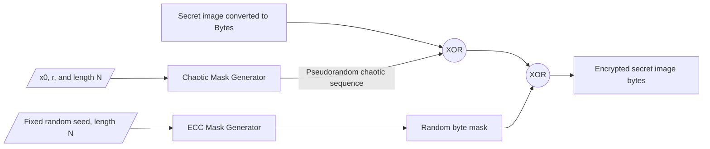

**Chaotic LSB Embedding and Extraction Algorithm**

1. Produce a pseudorandom mask with the logistic chaotic map for the secret image size.
2. Simulate an ECC mask as a strong random key.
3. XOR secret bytes with chaotic and ECC masks → encrypted payload.
4. Transform payload into a bit sequence.
5. Determine required number of LSBs; resize cover if needed so all bits fit.
6. Insert bits into LSBs of cover pixels → stego image.
7. Recover bits from stego LSBs, rebuild encrypted secret, decrypt using ECC and chaotic masks.
8. Calculate MSE, PSNR, SSIM, entropy, NPCR, UACI, correlation.
9. Visual analysis: save/display original, stego, encrypted, recovered images + histograms.
10. Results export: record metrics per test into a CSV file.

**Table 1 – Comparison between AES, 3DES and Chaotic LSB in the implemented methods**

| Aspect / Metric | 3DES-LSB | AES-LSB | Chaotic-LSB |
|---|---|---|---|
| Encryption algorithm | 192-bit 3DES (CBC, 8B IV) | 128-bit AES (CBC, 16B IV) | Chaotic + PRNG Masking Encryption |
| Block size | 64 bits | 128 bits | N/A (stream / byte-wise) |
| Key / Parameter | 24-byte key + 8-byte IV | 16-byte key + 16-byte IV | Logistic map (x0=0.785398, r=3.999), ECC simulated mask (random uint8 vector) |
| Padding | 8 bytes | 16 bytes | No block padding; byte stream / XOR |

### 4.4 Evaluation Parameters

#### 4.4.1 Visual Quality Analysis

Embedding may slightly change pixels; MSE, PSNR, SSIM measure imperceptibility.

**MSE (Mean Squared Error)** – pixel-wise error between original and stego; lower is better (ideal ≈ 0).

$$MSE = \frac{1}{M \times N}\sum_{i=0}^{M}\sum_{j=0}^{N}\left[I(i,j) - K(i,j)\right]^2 \tag{3}$$

- $M \times N$: total pixels; $I(i,j)$: original pixel; $K(i,j)$: stego pixel.

**PSNR (Peak Signal-to-Noise Ratio)** – extent of alteration in stego vs. original; higher is better.

$$PSNR = 10\log_{10}\left(\frac{255^2}{MSE}\right) \tag{4}$$

(Paper says "MSE measured with Eq. 1"; it actually refers to Eq. 3.)

**SSIM (Structural Similarity Index)** – similarity between original and stego.

$$SSIM(x,y) = \frac{(2\mu_x\mu_y + C_1)(2\sigma_{xy} + C_2)}{(\mu_x^2 + \mu_y^2 + C_1)(\sigma_x^2 + \sigma_y^2 + C_2)} \tag{5}$$

- $x, y$: original and stego images; $\mu_x, \mu_y$: means; $\sigma_x^2, \sigma_y^2$: variances; $\sigma_{xy}$: covariance; $C_1, C_2$: stabilizing constants.

#### 4.4.2 Statistical Analysis

**Histogram** – pixel intensity distribution. A stego image's histogram should closely mimic the cover's; an encrypted image's histogram should be **uniform** (high randomness → strong encryption, resistant to statistical detection).

#### 4.4.3 Differential Analysis

**NPCR (Number of Pixel Change Rate)** – how many pixels change between original and encrypted images (sensitivity to image/key changes).

$$NPCR = \frac{1}{mn}\sum_{i,j=1}^{mn} E_T(i,j) \times 100\% \tag{6}$$

$$E_T(i,j) = \begin{cases} 0 & \text{if } I_0(i,j) = I_e(i,j) \\ 1 & \text{if } I_0(i,j) \neq I_e(i,j) \end{cases}$$

- $m, n$: image dimensions; $I_0, I_e$: pixel values of original and encrypted images.

**UACI (Unified Average Change Intensity)** – average intensity difference between original and encrypted images; higher = stronger encryption; **33.44%** considered the minimum acceptable level.

$$UACI = \frac{1}{mn}\left(\sum_{i=0}^{m}\sum_{j=0}^{n}\frac{|I_0(i,j) - I_e(i,j)|}{255}\right) \times 100\% \tag{7}$$

#### 4.4.4 Entropy Analysis

Average information per pixel; measures randomness of encrypted image (ideal ≈ 8 for 8-bit).

$$H = -\sum_{i=0}^{L-1} p_i \log_2 p_i \tag{8}$$

- $H$: entropy; $L$: number of possible pixel values (256 for 8-bit grayscale); $p_i$: probability of pixel value $i$.

#### 4.4.5 Correlation Coefficient (CC)

Relationship between pixel values of original and encrypted images. Originals have strong correlation; encrypted images should have **CC ≈ 0**.

#### 4.4.6 Speed Analysis

Execution time of the algorithm; lower = more efficient.

## 5 Experimental Results and Discussion

**Dataset: Linnaeus 5** – colour images **256×256**, 5 classes: berry, bird, dog, flower, other. 1200 training + 400 test images per class. **All 8,000 images** used; metrics are averaged.

**Figure 3 – Cover image samples from Linnaeus 5 dataset**: grid of thumbnails, one row per class (berry, bird, dog, flower, other).

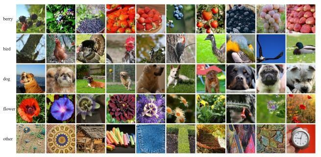

**Figure 4 – Cover and secret images with their histograms**

| Sample Cover Image (blackberries, 256×256 RGB) | Secret Image (grayscale coins – payload) |
|---|---|
| 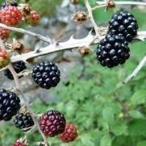 | 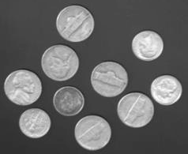 |
| 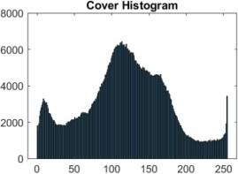 | 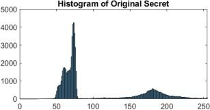 |
| Cover histogram: broad, smooth single hump peaking ~6500 around intensity 100–120, spanning ~0–255 | Secret histogram: very sharp spike (~4500) near intensity ~60–70 (dark background), small low bump ~170–220 (coins) |

The cover has rich colour and complex pixel patterns → good carrier.

**Figure 5 – Comparison of 3DES-LSB, AES-LSB and ECC Chaotic Steganography (encrypted secret images and histograms)**

| Row | 3DES-LSB | AES-LSB | Chaotic + PRNG Masking |
|---|---|---|---|
| 1. Encrypted secret image | 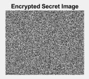 | 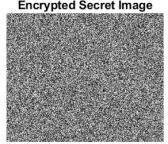 | 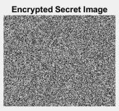 |
| 2. Histogram of encrypted secret |  | 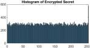 | 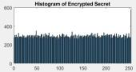 |
| 3. Stego histogram | 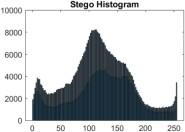 | 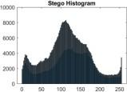 | 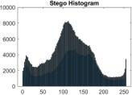 |

Interpretation (text-only summary of Figure 5):
- **Row 1**: all three encrypted secrets look like uniform random noise → strong encryption.
- **Row 2**: encrypted-secret histograms are nearly **flat/uniform** for all methods → high randomness, resistant to statistical attacks.
- **Row 3**: stego histograms closely match the cover histogram (same single-hump shape) → minimal embedding distortion.

**Table 2 – Statistical performance of 3DES, AES and Chaotic algorithms (averages over 8,000 images)**

| Metric | 3DES | AES | Chaotic + PRNG Masking |
|---|---|---|---|
| Avg. MSE | 0.499975 | 0.500006 | 0.499321 |
| Avg. PSNR (dB) | 51.15389 | 51.15373 | 51.14436 |
| Avg. SSIM | 0.998495 | 0.998494 | 0.998099 |
| Avg. EncTime (s) | 0.003552 | 0.000601 | 3.62E-05 |
| NPCR (%) | 99.59214 | 99.61924 | 99.63957 |
| UACI (%) | 30.80843 | 30.81756 | 30.96067 |
| Avg. Correlation | 0.00032 | -0.00407 | -0.00984 |
| Avg. Entropy | 7.047627 | 7.047762 | 6.952836 |

Observations from Table 2:
- Visual quality is almost identical across methods (PSNR ≈ 51.15 dB, SSIM ≈ 0.998).
- Chaotic is fastest by ~2 orders of magnitude (3.62e-5 s vs 6.01e-4 s AES vs 3.55e-3 s 3DES).
- Chaotic has marginally highest NPCR/UACI but lowest entropy (6.95 vs ~7.05).
- Note: all UACI values (~30.8–31.0%) are below the 33.44% threshold the paper itself cites; entropy is well below the ideal 8.

## 6 Conclusion

- All three methods (3DES-LSB, AES-LSB, Chaotic + PRNG Masking LSB) give excellent image quality and strong security (high PSNR, SSIM, NPCR, UACI).
- **ECC Chaotic** has significantly lower computation time → suited to speed-critical applications.
- ECC Chaotic shows the highest sensitivity to input changes (marginally better NPCR/UACI), but its slightly lower entropy needs further investigation for possible randomness weaknesses.
- Choice depends on application: **ECC Chaotic** for efficiency/fast processing; **AES / 3DES** for established security protocols.

## 7 Future Work

- Adaptive parameter tuning for ECC chaotic steganography (stronger encryption without losing speed).
- Combine SLMM with advanced embedding techniques to raise capacity while keeping imperceptibility.
- Evaluate resistance to emerging steganalysis attacks.
- Extend to video and audio.
- Build a comprehensive system integrating these improvements for real-world use.

## References

1. Abbas, Z., Chong, K. T. (2023). A Novel Approach Towards Fusion of Steganography and Cryptography for Enhanced Data Security Using RGB Image. IEEE Int. Conf. on Electro Information Technology, pp. 309–313.
2. AL-Shaaby, A. A., AlKharobi, T. (2017). Cryptography and Steganography: New Approach. Transactions on Networks and Communications 5(6). doi:10.14738/tnc.56.3914.
3. Arora, H., Soni, G. K., Kushwaha, R. K., Prasoon, P. (2021). Digital Image Security Based on the Hybrid Model of Image Hiding and Encryption. ICCES 2021, pp. 1153–1157. (Also listed as an undated duplicate.)
4. Awadh, W. A., Alasady, A. S., Hamoud, A. K. (2022). Hybrid Information Security System via Combination of Compression, Cryptography, and Image Steganography. IJECE 12(6):6574–84. doi:10.11591/ijece.v12i6.pp6574-6584.
5. Babu, V. S., Helen K. J. (2015). A Study on Combined Cryptography and Steganography. Vol. 2. arcjournals.org.
6. Basri, M., Mawengkang, H., Zamzami, E. M. (2018). Cloud Computing Security Model with Combination of DES and LSB. J. Phys.: Conf. Series, Vol. 970.
7. Chikouche, S. L., Noureddine, C. (2017). An Improved Approach for LSB-Based Image Steganography Using AES Algorithm. ICEE-B, IEEE.
8. Karthikeyan, B., Deepak, A., Subalakshmi, K. S. (2017). A Combined Approach of Steganography with LSB Encoding Technique and DES Algorithm. AEEICB17, IEEE.
9. Kaushik, P., Jain, M., Jain, A. (2018). A Pixel-Based Digital Medical Images Protection Using Genetic Algorithm. Vol. 11. irphouse.com.
10. Kotkar, A., Khadapkar, S., Gupta, A., Jangale, S. (2022). Multiple Layered Security Using Combination of Cryptography with Rotational, Flipping Steganography and Message Authentication. ICDSIS 2022, IEEE.
11. Kumar, S., Nagar, H., Kumar, M. (2020). Comparative Analysis of Different Steganography Technique for Image or Data Security. IJAST 29(4):11246–53.
12. Mittal, M., Gupta, S., Keserwani, P. K., Govil, M. C. (2023). Security Enhancement Using Vectoring, Cryptography and Steganography. ISACC 2023, IEEE.
13. Rashmi N., Jyothi K. (2018). An Improved Method for Reversible Data Hiding Steganography Combined with Cryptography. Int. Conf. on Inventive Systems and Control, p. 908.
14. Pekerti, A. A., Sasongko, A., Indrayanto, A. (2024). Secure End-to-End Voice Communication: A Comprehensive Review of Steganography, Modem-Based Cryptography, and Chaotic Cryptography Techniques. IEEE Access 12:75146–68. doi:10.1109/ACCESS.2024.3405317.
15. Radha S. Phadte (2017). Enhanced Blend of Image Steganography And [Cryptography]. IEEE.
16. Taha, M. S., Rahim, M. S. M., Lafta, S. A., Hashim, M. M., Alzuabidi, H. M. (2019). Combination of Steganography and Cryptography: A Short Survey. IOP Conf. Series: MSE, Vol. 518.
17. Tripathi, R., Umrao, L. S., Tripathi, A. (2021). Review on Metamorphic Cryptography: A Combined Approach of Cryptography and Steganography Techniques. ICACFCT 2021, pp. 237–242.

*(Cited in text but missing from the reference list: Yang et al. 2014; M. Kumar et al. 2022; Ranjan & Bhosale 2016.)*
