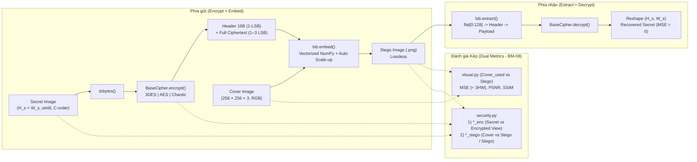

# Đặc tả Kỹ thuật Toàn diện (Technical Specification)

**Dự án:** Tái hiện bài báo *"A Hybrid Crypto-Steganography Framework for Secure Image Transfer"* (Snehal Dipak Raut et al., ICITSC 2025, trang 175–182) từ MATLAB R2024a sang Python 3.12.  
**Môn học:** CT204 – An toàn và Bảo mật Thông tin.  
**Tài liệu liên kết:** [Docs/145987.md](../Docs/145987.md) | [03_TECHNICAL_BLIND_SPOTS_AND_DECISIONS.md](./03_TECHNICAL_BLIND_SPOTS_AND_DECISIONS.md) *(Hồ sơ lý giải 10 quyết định thiết kế BM-01 → BM-10)*

---

## 1. Kiến trúc Tổng thể & Quy ước Biểu diễn Dữ liệu

Hệ thống bảo vệ ảnh bí mật qua **2 lớp bảo mật nối tiếp**:
1. **Cryptography Layer (`src/crypto/`):** Biến đổi ảnh xám bí mật $S \in \{0,\dots,255\}^{H_s \times W_s}$ thành chuỗi byte bản mã nhiễu ngẫu nhiên bằng một trong 3 thuật toán theo mẫu thiết kế **Strategy Pattern** (`3DES-CBC`, `AES-128-CBC`, `Chaotic Logistic Map + Simulated ECC Mask`).
2. **Steganography Layer (`src/stego/lsb.py`):** Đóng gói bản mã kèm Header 16-byte tự mô tả rồi nhúng vào **1–3 bit ít quan trọng nhất (LSB)** trên 3 kênh màu R, G, B của ảnh phủ $C \in \{0,\dots,255\}^{256 \times 256 \times 3}$ (tự động phóng đại ảnh phủ nếu vượt sức chứa 3 LSB), xuất ra ảnh Stego định dạng nén không mất dữ liệu (`.png`).

### Quy ước Biểu diễn Bộ nhớ Chuẩn (Theo quyết định `BM-01`, `BM-02`)
- **Thứ tự mảng (`BM-02`):** Toàn bộ mảng ảnh trong hệ thống chuẩn hóa theo **`Row-major` (C-contiguous)** của NumPy:
  - Ảnh bí mật (`secret`): mảng 2D `uint8` kích thước `(H_s, W_s)`. Chuyển sang byte bằng `np.ascontiguousarray(secret, dtype=np.uint8).tobytes()`.
  - Ảnh phủ / ảnh giấu tin (`cover` / `stego`): mảng 3D `uint8` theo thứ tự kênh **RGB** `(H_c, W_c, 3)` (pixel-interleaved). Mọi thao tác đọc/ghi qua OpenCV (`cv2.imread`/`cv2.imwrite`) phải chuyển đổi `BGR ↔ RGB` ngay tại ranh giới hàm I/O.
- **Kích thước chuẩn của ảnh bí mật mẫu (`BM-01`):**
  - File mẫu mặc định `SOURCES/data/sample/secret.png` được chuẩn hóa về kích thước **`246 × 300` (`73,800` bytes)** — khớp chính xác với ảnh `coins.png` của MATLAB được tác giả dùng ở Hình 4–5.
  - Tham số `secret.resize` trong `default.yaml` (hoặc cờ CLI `--secret-size H W`) hỗ trợ chuyển đổi linh hoạt sang **`[156, 156]` (`24,336` bytes, lấp ~99.1% sức chứa 1-LSB của ảnh `256×256×3`)** để tái hiện điều kiện `MSE ≈ 0.50, PSNR ≈ 51.15 dB` của Bảng 2.



---

## 2. Hợp đồng Cấu hình Chuẩn (Khớp Giai đoạn 1)

Mọi module từ Giai đoạn 2–4 **bắt buộc** đọc cấu hình qua `src.config.load_config()` từ [SOURCES/configs/default.yaml](../SOURCES/configs/default.yaml):

| Nhóm | Khóa YAML đầy đủ | Kiểu từ `load_config()` | Giá trị mặc định | Ghi chú kỹ thuật |
|---|---|---|---|---|
| `paths` | `paths.data_dir` | `Path` (tuyệt đối) | `SOURCES/data/linnaeus5` | `{train,test}/{berry,bird,dog,flower,other}/*.jpg` |
| `paths` | `paths.sample_dir` | `Path` (tuyệt đối) | `SOURCES/data/sample` | Chứa `secret.png` (`246×300`) & `cover.jpg` |
| `paths` | `paths.results_dir` | `Path` (tuyệt đối) | `SOURCES/results` | Lưu ảnh `.png`, histogram và file `.csv` |
| `crypto` | `crypto.key_seed` | `int` | `2025` | Hạt giống gốc sinh key/IV tất định (tách miền SHA-256) |
| `crypto` | `crypto.des3.key_bytes` | `int` | `24` | 192-bit 3DES (3-key EDE) |
| `crypto` | `crypto.des3.iv_bytes` | `int` | `8` | 64-bit IV cho CBC |
| `crypto` | `crypto.aes.key_bytes` | `int` | `16` | 128-bit AES |
| `crypto` | `crypto.aes.iv_bytes` | `int` | `16` | 128-bit IV cho CBC |
| `crypto` | `crypto.chaotic.x0` | `float` | `0.785398` | Điều kiện đầu Logistic Map (Eq. 1) |
| `crypto` | `crypto.chaotic.r` | `float` | `3.999` | Tham số hỗn loạn Logistic Map (Eq. 1) |
| `crypto` | `crypto.chaotic.ecc_seed` | `int` | `42` | Seed cố định sinh mặt nạ ECC mô phỏng |
| `stego` | `stego.cover_size` | `list[int]` | `[256, 256]` | `[H_c, W_c]` chuẩn của ảnh cover |
| `stego` | `stego.max_lsb` | `int` | `3` | Số bit LSB tối đa trên mỗi kênh R, G, B |
| `stego` | `stego.header_lsb` | `int` | `1` | Số bit LSB cố định cho vùng Header (`flat[0:128]`) |
| `stego` | `stego.scale_up_interpolation` | `str` | `"cubic"` | Ánh xạ sang `cv2.INTER_CUBIC` |
| `secret` | `secret.path` | `Path` (tuyệt đối) | `SOURCES/data/sample/secret.png` | Ảnh xám bí mật (`246×300` chuẩn MATLAB) |
| `secret` | `secret.resize` | `list[int] \| None` | `null` | `null` giữ `246×300`; `[156, 156]` để chạy kịch bản 1-LSB Bảng 2 |
| `benchmark` | `benchmark.ciphers` | `list[str]` | `["3des", "aes", "chaotic"]` | Danh sách thuật toán chạy batch |
| `benchmark` | `benchmark.splits` | `list[str]` | `["train", "test"]` | Tập con Linnaeus 5 (tổng 8,000 ảnh) |
| `benchmark` | `benchmark.csv_name` | `str` | `"benchmark_results.csv"` | Xuất tại `paths.results_dir / csv_name` |

---

## 3. Đặc tả Chi tiết Từng Module (Đã tích hợp Quyết định `BM-01` → `BM-10`)

### 3.1 Giai đoạn 2: Tầng Mã hóa (`SOURCES/src/crypto/`)

#### 3.1.1 `src/crypto/base.py` (Quyết định `BM-03`, `BM-05`)
```python
class BaseCipher(ABC):
    @property
    @abstractmethod
    def name(self) -> str:
        """Tên chuẩn hóa: '3des' | 'aes' | 'chaotic'."""

    @property
    def block_size(self) -> int | None:
        """Kích thước khối tính bằng byte (8 cho 3DES, 16 cho AES, None cho Chaotic)."""
        return None

    @abstractmethod
    def encrypt(self, plaintext: bytes) -> bytes:
        """Mã hóa chuỗi byte đầu vào thành chuỗi byte bản mã."""

    @abstractmethod
    def decrypt(self, ciphertext: bytes) -> bytes:
        """Giải mã chuỗi byte bản mã về nguyên bản plaintext."""

    def warmup(self) -> None:
        """Khởi động trước khi đo EncTime (dùng cho Numba JIT ở ChaoticCipher)."""
        return None


def derive_bytes(seed: int, length: int, label: str) -> bytes:
    """Sinh chuỗi byte tất định tách miền (BM-03):
    digest = hashlib.sha256(f'{seed}:{label}'.encode('utf-8')).digest()
    rng = np.random.default_rng(int.from_bytes(digest, 'big'))
    return rng.integers(0, 256, size=length, dtype=np.uint8).tobytes()
    """


def ciphertext_to_image_view(ciphertext: bytes, secret_shape: tuple[int, int]) -> np.ndarray:
    """Chuyển bản mã sang mảng 2D (H_s, W_s) uint8 phục vụ hiển thị & tính NPCR/UACI (BM-05).
    Cắt đúng H_s * W_s byte đầu (bỏ phần byte dôi PKCS7 ở cuối mà KHÔNG đệm 255 giả tạo).
    """
```

#### 3.1.2 `src/crypto/des3_cipher.py` (`DES3Cipher` — Quyết định `BM-03`, `BM-05`)
- **Thuật toán:** 3DES-192 (EDE), chế độ CBC (`DES3.MODE_CBC`), đệm chuẩn **PKCS#7** (`block_size = 8`).
- **Chữ ký:**
  - `__init__(self, key: bytes, iv: bytes) -> None`
  - `@classmethod def from_config(cls, cfg: dict[str, Any], *, seed_offset: int = 0) -> DES3Cipher`
    *(Tham số `seed_offset` mặc định `0` giữ khóa cố định từ `crypto.key_seed`; khi truyền `seed_offset = img_idx` hỗ trợ chế độ `--vary-key-per-image` ở `BM-03`.)*
- **Ràng buộc bắt buộc:**
  1. Kiểm tra `len(key) == 24`, `len(iv) == 8`.
  2. Gọi `DES3.adjust_key_parity(key)` và thử tạo `DES3.new(adjusted_key, DES3.MODE_CBC, iv=iv)` ngay trong `__init__` để bắt lỗi khóa suy biến ($K_1 = K_2$ hoặc $K_2 = K_3$). Trong `from_config`, dùng nhãn `f"3des:key:{attempt}"` tăng dần `attempt` nếu rơi vào khóa suy biến, và nhãn `"3des:iv"` cho IV.
  3. Tạo mới đối tượng `DES3.new(...)` trong **mỗi lần gọi** `encrypt()` / `decrypt()` để không rò rỉ trạng thái CBC.
  4. Khi `decrypt`: kiểm tra `len(ciphertext) > 0` và `len(ciphertext) % 8 == 0` trước khi `unpad(..., 8, style="pkcs7")`.

#### 3.1.3 `src/crypto/aes_cipher.py` (`AESCipher` — Quyết định `BM-03`, `BM-05`)
- **Thuật toán:** AES-128, chế độ CBC (`AES.MODE_CBC`), đệm chuẩn **PKCS#7** (`block_size = 16`).
- **Chữ ký:**
  - `__init__(self, key: bytes, iv: bytes) -> None`
  - `@classmethod def from_config(cls, cfg: dict[str, Any], *, seed_offset: int = 0) -> AESCipher`
- **Ràng buộc bắt buộc:**
  1. Kiểm tra `len(key) == 16`, `len(iv) == 16`; dùng nhãn `"aes:key"` và `"aes:iv"` trong `derive_bytes(key_seed + seed_offset, ...)`.
  2. Tạo mới `AES.new(self._key, AES.MODE_CBC, iv=self._iv)` mỗi lần gọi `encrypt()` / `decrypt()`.
  3. Kiểm tra `len(ciphertext) > 0` và `len(ciphertext) % 16 == 0` khi giải mã.

#### 3.1.4 `src/crypto/chaotic_cipher.py` (`ChaoticCipher` — Quyết định `BM-04`, `BM-10`)
- **Thuật toán & Quy tắc lượng tử hóa cố định (`BM-04`):**
  - Sinh chuỗi hỗn loạn Logistic Map trên kiểu `float64` bằng `@numba.njit(cache=True)`:
    $$x_{n+1} = r \cdot x_n \cdot (1 - x_n), \quad \text{chaosMask}[n] = \text{clip}\left(\lfloor x_{n+1} \times 256.0 \rfloor,\, 0,\, 255\right), \quad n = 0, \dots, N-1$$
    *(Bắt đầu lưu từ $x_1$, bỏ qua giá trị khởi tạo $x_0$.)*
  - Sinh mặt nạ ECC mô phỏng:
    $$\text{eccMask} = \text{np.random.default\_rng}(\text{ecc\_seed}).\text{integers}(0, 256, \text{size}=N, \text{dtype}=\text{np.uint8})$$
  - Phép mã hóa / giải mã (Stream XOR đối xứng, không block padding):
    $$\text{out} = S \oplus \text{chaosMask} \oplus \text{eccMask}$$
- **Chữ ký & Chế độ Cache Tường minh (`BM-10`):**
  ```python
  class ChaoticCipher(BaseCipher):
      def __init__(
          self,
          x0: float,
          r: float,
          ecc_seed: int,
          *,
          cache_mask: bool = False,
      ) -> None: ...

      @classmethod
      def from_config(
          cls,
          cfg: dict[str, Any],
          *,
          seed_offset: int = 0,
          cache_mask: bool = False,
      ) -> ChaoticCipher: ...

      def warmup(self) -> None:
          """Biên dịch trước hàm @numba.njit trên mảng nháp 16 bytes."""
  ```
  - **`seed_offset` trên `ChaoticCipher`:** Chỉ cộng `seed_offset` vào `ecc_seed` (giữ nguyên `x0 = 0.785398` và `r = 3.999` của bài báo để không rơi khỏi miền hỗn loạn).
  - **Mặc định `cache_mask = False`:** Mỗi lần gọi `encrypt`/`decrypt` đều tính động `chaos_mask` (qua Numba JIT `logistic_mask(x0, r, n)`) và `ecc_mask` để phản ánh trung thực chi phí toàn phần của thuật toán.
  - **Khi bật `cache_mask = True`:** Lưu cache cặp mặt nạ tổng hợp `combined_mask(n) = chaos_mask ^ ecc_mask` theo độ dài `N` gần nhất để phục vụ thí nghiệm đo tốc độ XOR keystream thuần (đối chiếu con số `3.62e-5 s` của Bảng 2). *(Lưu ý: không sửa in-place mảng trả về từ `combined_mask`).*
- **Kiểm tra biên:** Ném `ValueError` nếu không thỏa `0.0 < x0 < 1.0` hoặc `0.0 < r <= 4.0` (kể cả `NaN`/`Inf`); trả về `b""` nếu đầu vào `b""`.

#### 3.1.5 `src/crypto/__init__.py` (Factory)
```python
def create_cipher(
    name: str,
    cfg: dict[str, Any],
    *,
    seed_offset: int = 0,
    cache_chaotic_mask: bool = False,
) -> BaseCipher:
    """Khởi tạo cipher từ tên ('3des' | 'des3' | 'aes' | 'chaotic') và cấu hình."""
```

---

### 3.2 Giai đoạn 3: Tầng Giấu tin LSB (`SOURCES/src/stego/lsb.py`) & Pipeline (`SOURCES/src/pipeline.py`)

#### 3.2.1 Giao thức Nhị phân Header 16-byte (Quyết định `BM-06`)

Đóng gói cố định **16 bytes = 128 bits** theo Big-Endian `struct.Struct(">4sBBHHIH")`:

| Offset (Byte) | Trường | Kiểu | Độ lớn | Mô tả |
|---|---|---|---|---|
| `0..3` | `magic` | `4s` | 4 B | Hằng số `b"HCST"` |
| `4` | `version` | `B` | 1 B | Phiên bản = `1` |
| `5` | `num_lsb` | `B` | 1 B | Số LSB dùng cho vùng Payload (`1..max_lsb`) |
| `6..7` | `secret_h` | `H` | 2 B | Chiều cao ảnh bí mật $H_s$ (`1..65535`) |
| `8..9` | `secret_w` | `H` | 2 B | Chiều rộng ảnh bí mật $W_s$ (`1..65535`) |
| `10..13` | `ciphertext_len` | `I` | 4 B | Số byte chính xác của `ciphertext` (gồm cả PKCS#7 padding) |
| `14..15` | `crc16` | `H` | 2 B | `zlib.crc32(header[:14]) & 0xFFFF` kiểm tra toàn vẹn Header |

#### 3.2.2 Phân vùng Kênh màu, Chọn `num_lsb` & Auto Scale-up (Quyết định `BM-06`, `BM-07`)

Trên mảng kênh màu trải phẳng C-order `flat = cover_used.reshape(-1)` có tổng độ dài $M = H_c \cdot W_c \cdot 3$:
1. **Vùng Header (`flat[0:128]`):** Luôn nhúng 128 bit Header vào **`header_lsb = 1` LSB** đầu tiên (`(flat[:128] & 0xFE) | header_bits`).
2. **Quy tắc bậc thang `num_lsb` & Phóng đại ảnh Cover (`BM-07`):**
   - Số kênh dành cho Payload: $M_{\text{avail}} = M - 128$. Số bit bản mã: $B = 8 \times \text{ciphertext\_len}$.
   - Nếu tồn tại $k \in \{1, \dots, \text{max\_lsb}\}$ sao cho $B \le M_{\text{avail}} \cdot k$: chọn $k$ nhỏ nhất, giữ nguyên ảnh cover (`was_scaled_up = False`).
   - Nếu $B > M_{\text{avail}} \cdot \text{max\_lsb}$ (vượt sức chứa 3-LSB):
     - Giữ `num_lsb = max_lsb` ($3$).
     - Tính $M_{\text{req}} = \lceil B / \text{max\_lsb} \rceil + 128$, hệ số phóng đại đẳng hướng $s = \sqrt{M_{\text{req}} / (H_c \cdot W_c \cdot 3)}$.
     - Kích thước mới $H'_c = \lceil H_c \cdot s \rceil$, $W'_c = \lceil W_c \cdot s \rceil$ (nếu $3 H'_c W'_c < M_{\text{req}}$ thì cộng thêm `1` vào chiều nhỏ hơn).
     - Phóng đại ảnh cover bằng `cv2.resize(cover_rgb, (W'_c, H'_c), interpolation=cv2.INTER_CUBIC)` tạo thành `cover_used`, đặt `was_scaled_up = True`.
3. **Vùng Payload (`flat[128 : 128 + N_used]`):**
   - Đệm `0` tối đa $k - 1$ bit ở cuối mảng bit bản mã cho chẵn bội số của $k$, gom nhóm `(N_used, k)` và ghi vào $k$ bit thấp bằng phép mặt nạ bit NumPy vector hóa **100% không vòng lặp pixel**.

#### 3.2.3 Chữ ký hàm trong `src/stego/lsb.py` & `src/pipeline.py`
```python
@dataclass(frozen=True)
class EmbedResult:
    stego_rgb: np.ndarray          # Ảnh stego sau nhúng (H'_c, W'_c, 3) uint8
    cover_used_rgb: np.ndarray     # Ảnh cover cùng kích thước (H'_c, W'_c, 3) dùng đối chiếu MSE/PSNR (BM-07)
    num_lsb: int                   # Số LSB thực tế đã dùng cho payload (1..3)
    secret_shape: tuple[int, int]
    ciphertext_len: int
    was_scaled_up: bool


def embed(
    cover_rgb: np.ndarray,
    ciphertext: bytes,
    secret_shape: tuple[int, int],
    *,
    max_lsb: int = 3,
    interpolation: str = "cubic",
) -> EmbedResult: ...


def extract(stego_rgb: np.ndarray) -> tuple[bytes, tuple[int, int], int]:
    """Trả về (ciphertext, secret_shape, num_lsb) độc lập 100% từ ảnh stego.
    Ném ValueError nếu ảnh quá nhỏ (< 128 kênh), sai magic 'HCST', sai CRC16, hoặc tràn biên.
    """
```
- Trong `src/pipeline.py` (các hàm đã chốt từ Giai đoạn 3):
  - I/O an toàn Unicode Windows (`np.fromfile` + `cv2.imdecode` / `cv2.imencode` + `tofile`): `read_rgb(path, size=None)`, `read_gray(path, size=None)`, `save_stego_png(path, stego_rgb)` (bắt buộc đuôi `.png`).
  - Nghiệp vụ: `hide(secret, cover_rgb, cipher, ...)`, `reveal(stego_rgb, cipher)`, `run_pipeline(...) -> PipelineResult`, `run_from_config(...) -> PipelineResult`.
  - Ở Giai đoạn 4: tích hợp bấm giờ `enc_time_s` quanh `cipher.encrypt(...)` (sau `warmup` khi bật) và điền đầy đủ `PipelineResult.metrics` (mặc định `compute_metrics: bool = True`).

---

### 3.3 Giai đoạn 4: Tầng Đánh giá (`SOURCES/src/metrics/`) & Scripts (`SOURCES/scripts/`)

#### 3.3.1 `src/metrics/visual.py` (Quyết định `BM-07`, `BM-09`)
So sánh giữa `cover_used_rgb` và `stego_rgb` (cùng kích thước `(H, W, 3)`):
- **`mse(img_a: np.ndarray, img_b: np.ndarray) -> float` (`BM-09`):**
  $$\text{MSE} = \frac{1}{H \cdot W \cdot C} \sum \left(\text{float64}(I_a) - \text{float64}(I_b)\right)^2$$
  *(Chia cho tổng phần tử $H \times W \times 3$ trên ảnh RGB, tương đương chính xác `immse` của MATLAB.)*
- **`psnr(img_a: np.ndarray, img_b: np.ndarray) -> float`:** $10 \log_{10}(255^2 / \text{MSE})$ (trả về `float("inf")` khi $\text{MSE} == 0$).
- **`ssim(img_a: np.ndarray, img_b: np.ndarray) -> float`:** `skimage.metrics.structural_similarity(..., data_range=255, channel_axis=-1)` cho ảnh 3D (hoặc `channel_axis=None` cho ảnh 2D).

#### 3.3.2 `src/metrics/security.py` (Quyết định `BM-08`, `BM-09`, `BM-10`)
- **`measure_enc_time(cipher: BaseCipher, plaintext: bytes, *, warmup: bool = True) -> tuple[bytes, float]`:**
  - Nếu `warmup=True`: gọi `cipher.warmup()` trước khi đo.
  - Bấm giờ `time.perf_counter()` bao quanh duy nhất lệnh `cipher.encrypt(plaintext)`.
- **`npcr(img_a: np.ndarray, img_b: np.ndarray) -> float`:** Tỷ lệ phần trăm phần tử khác nhau (`!=`).
- **`uaci(img_a: np.ndarray, img_b: np.ndarray) -> float`:** Trung bình `|float64(img_a) - float64(img_b)| / 255.0 * 100.0`.
- **`shannon_entropy(img: np.ndarray) -> float`:** $-\sum_{v=0}^{255} p_v \log_2(p_v)$ với `np.bincount(img.ravel(), minlength=256)`.
- **`cross_correlation(img_a: np.ndarray, img_b: np.ndarray) -> float` (`BM-09`):**
  - Nếu ảnh 2D: tương quan Pearson giữa `img_a.ravel()` và `img_b.ravel()`.
  - Nếu ảnh 3D `(H, W, 3)`: trung bình cộng tương quan Pearson trên 3 kênh R, G, B (*"mean RGB channel correlation"*).
  - Trả về `0.0` nếu độ lệch chuẩn của một kênh bằng `0`.
- **`adjacent_pixel_correlation(img: np.ndarray, direction: str = "horizontal") -> float`:** Tương quan cặp pixel kề nhau theo chiều ngang / dọc / chéo phục vụ phân tích chuyên sâu.
- **`compute_dual_security_metrics(secret_gray, encrypted_view_gray, cover_used_rgb, stego_rgb) -> dict[str, float]` (`BM-08`):**
  Trả về đầy đủ cả 2 bộ chỉ số:
  - Nhóm mã hóa (`Secret vs. Encrypted View`): `npcr_enc`, `uaci_enc`, `corr_enc`, `entropy_enc`.
  - Nhóm ảnh giấu tin (`Cover vs. Stego & Stego`): `npcr_stego`, `uaci_stego`, `corr_stego`, `entropy_stego`.

#### 3.3.3 `scripts/run_single.py` & `scripts/run_benchmark.py` (Quyết định `BM-01`, `BM-08`, `BM-10`)
- **`scripts/run_single.py`:**
  - Hỗ trợ CLI: `--config`, `--cover`, `--secret`, `--secret-size H W`, `--cache-chaotic-mask`.
  - Nếu `data/sample/secret.png` chưa tồn tại, tự động khởi tạo từ `skimage.data.coins()` resize `cv2.INTER_AREA` về `(246, 300)` chuẩn MATLAB (`BM-01`).
  - **Quy chuẩn vẽ Histogram (`BM-10`):**
    - Với ảnh xám (`Secret`, `Encrypted Secret`): `img.ravel()` trên 256 bins `[0, 256)`.
    - Với ảnh màu RGB (`Cover`, `Stego`): **trải phẳng gộp cả 3 kênh `img_rgb.ravel()`** trên 256 bins `[0, 256)` với 1 màu cột thống nhất — tái hiện chính xác hình dạng và thang trục tung (`0..8000+`) của Hình 4c & Hình 5 trong bài báo gốc.
  - Xuất ảnh rời + `fig4_cover_secret_histograms.png` + `fig5_comparison_grid.png` vào `results/single/`.
- **`scripts/run_benchmark.py`:**
  - Hỗ trợ CLI: `--config`, `--limit N`, `--secret-size H W`, `--vary-key-per-image`, `--cache-chaotic-mask`.
  - Warm-up tất cả cipher 1 lần trước vòng lặp `tqdm` trên 8,000 ảnh Linnaeus 5.
  - Xuất 2 file CSV vào `paths.results_dir`:
    1. `benchmark_results.csv`: toàn bộ dòng chi tiết từng `(image, split, class, cipher)` với đầy đủ `mse`, `psnr`, `ssim`, `enc_time_s`, `num_lsb`, `was_scaled_up`, nhóm `*_enc` và nhóm `*_stego`.
    2. `benchmark_summary_table2.csv`: bảng trung bình theo từng thuật toán gồm cả **chế độ chuẩn lý thuyết** lẫn **cột đối chiếu khớp Bảng 2 bài báo** (`mse`, `psnr`, `ssim`, `enc_time_s`, `npcr_enc`, `uaci_enc`, `corr_enc`, `entropy_stego`, `entropy_enc`).
